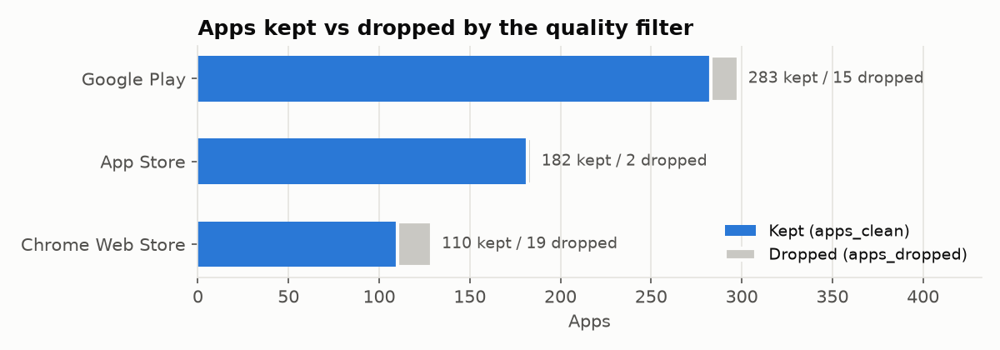
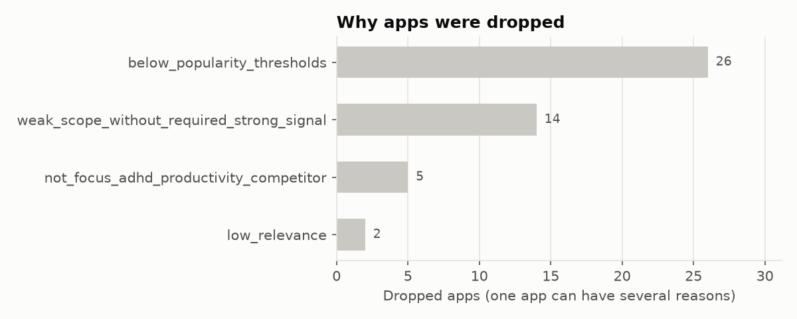
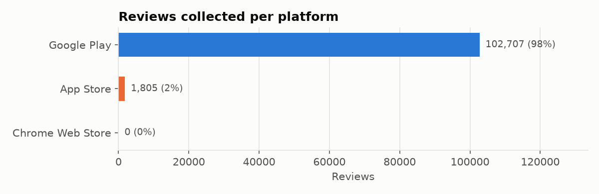
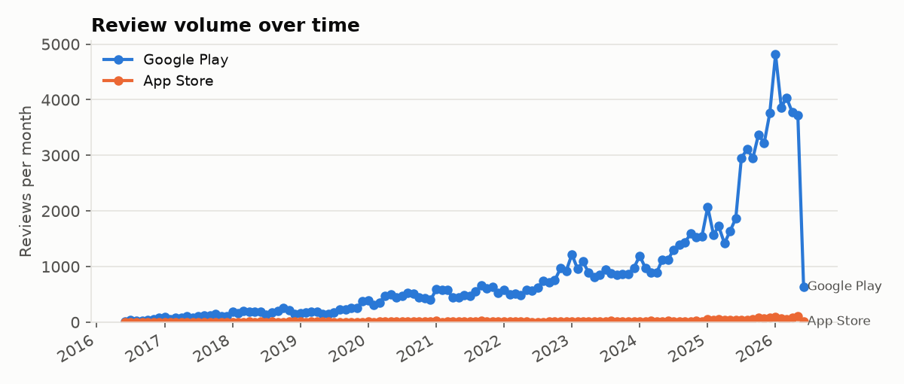
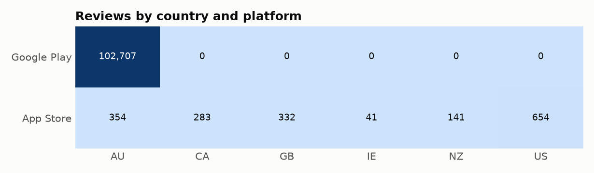
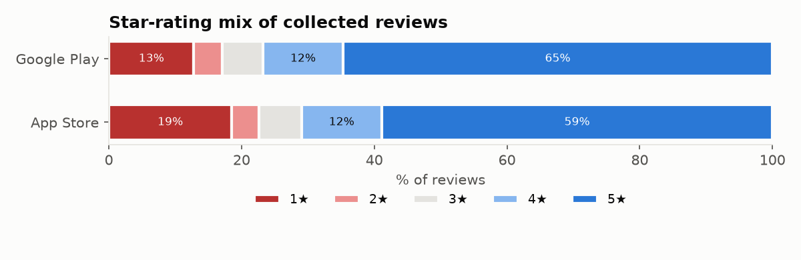
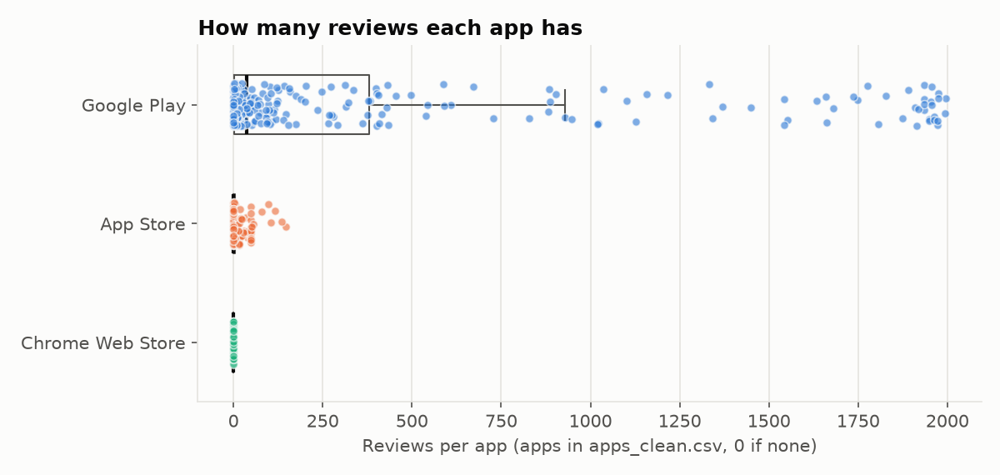
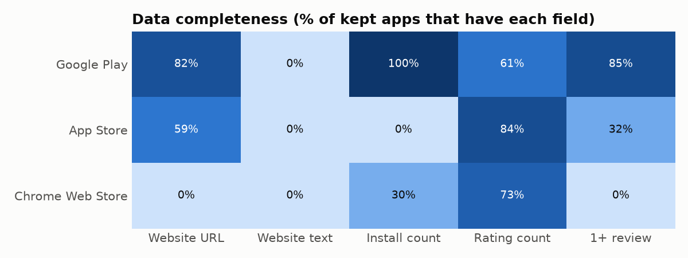

# Dataset summary

_Auto-generated by `scripts/dataset_summary.py` on 2026-10-08 01:48 UTC at commit `f630eed`. Do not edit by hand - it is rewritten on every pipeline run._

## At a glance

| Question | Answer |
|---|---|
| How many apps? | **575** kept in `apps_clean.csv` (of 613 in `apps_all.csv`; 36 dropped) |
| How many reviews? | **104,512** rows in `reviews.csv` (104,512 unique review IDs) |
| From where? | Google Play: 283 apps, 102,707 reviews; App Store: 182 apps, 1,805 reviews; Chrome Web Store: 110 apps, 0 reviews |
| From when? | 2016-06-10 to 2026-06-05 |

> **Heads-up**
>
> - All Google Play reviews are labelled country `au`. Google Play returns the same reviews for every country and duplicates are removed, so this does not mean they are all from `au` - Play reviews are effectively not country-specific.
> - Chrome Web Store apps have no reviews: the reviews step only scrapes `play` and `ios`.
> - `websites.csv` has only 1 row for 575 apps, so the websites step was probably not run for this dataset. Website-text counts below are not meaningful.

## Collection settings

| Setting | Value |
|---|---|
| Review cap (max reviews per app, per country, per language) | 2,000 |
| Stores scraped for reviews | - |
| Countries | au,us,gb,ca,nz,ie |
| Languages | en |
| Only reviews from the last N days | - |
| Settings recorded at | 2026-10-08T01:48:53+00:00 |

Seen in the data itself: countries **au, ca, gb, ie, nz, us**, languages **en**. Most reviews for one app in one country/language: **1,995** (if the cap was not recorded, it is probably the round number just above this).

## Apps per platform

| Platform | apps_all.csv | apps_clean.csv | apps_dropped.csv |
|---|---:|---:|---:|
| Google Play | 299 | 283 | 15 |
| App Store | 185 | 182 | 2 |
| Chrome Web Store | 129 | 110 | 19 |
| **Total** | **613** | **575** | **36** |

## Reviews per platform

| Platform | Reviews | Apps with reviews | Oldest review | Newest review |
|---|---:|---:|---|---|
| Google Play | 102,707 | 240 | 2016-06-10 | 2026-06-05 |
| App Store | 1,805 | 59 | 2016-06-12 | 2026-06-04 |
| Chrome Web Store | 0 | 0 | - | - |
| **Total** | **104,512** | **299** | 2016-06-10 | 2026-06-05 |

## Reviews per app

Counted over every app in `apps_clean.csv`; an app with no reviews counts as 0. *Apps at the cap* = apps where at least one country/language hit the review cap, so they probably have more reviews than we collected.

| Platform | Apps | Min | Median | Max | Apps with 0 reviews | Apps at the cap |
|---|---:|---:|---:|---:|---:|---:|
| Google Play | 283 | 0 | 37 | 1,995 | 43 | 0 |
| App Store | 182 | 0 | 0 | 146 | 123 | 0 |
| Chrome Web Store | 110 | 0 | 0 | 0 | 110 | 0 |
| **All** | 575 | 0 | 1 | 1,995 | 276 | 0 |

## Website text and install counts

| Platform | Apps | With website text | With install count | With website URL |
|---|---:|---:|---:|---:|
| Google Play | 283 | 0 | 282 | 231 |
| App Store | 182 | 0 | 0 | 108 |
| Chrome Web Store | 110 | 0 | 33 | 0 |
| **All** | 575 | 0 | 315 | 339 |

App Store does not publish install counts, so 0 there is expected. Website text comes from `websites.csv` (non-empty `website_text`).

## Other data files in the repo

Older or larger datasets that the current pipeline outputs above do **not** come from. Listed so you know what exists; not used in any number above.

| File | Rows | Google Play | App Store | Chrome Web Store |
|---|---:|---:|---:|---:|
| `data/curated/apps_all_clean.csv` | 310 | 104 | 147 | 59 |
| `data/reviews/reviews.jsonl` | 63,997 | 54,468 | 9,529 | 0 |
